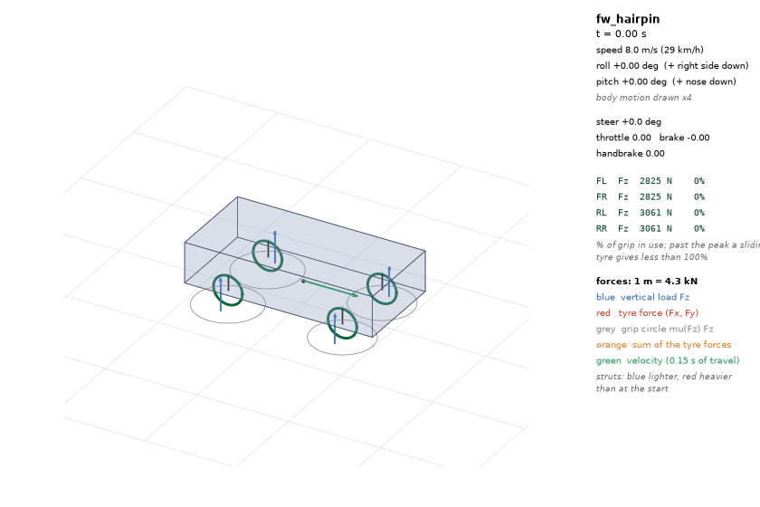
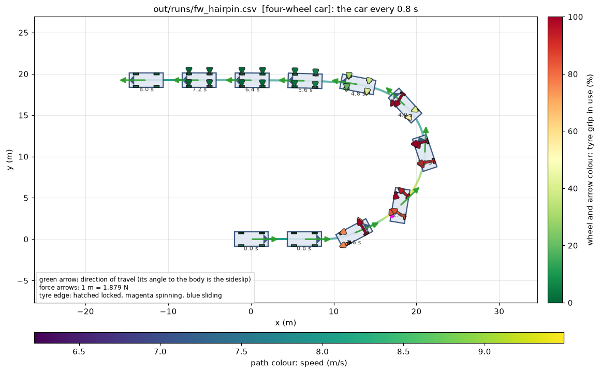
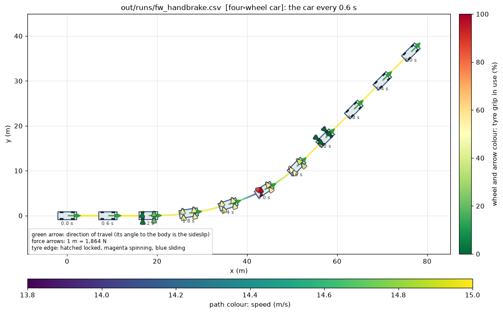
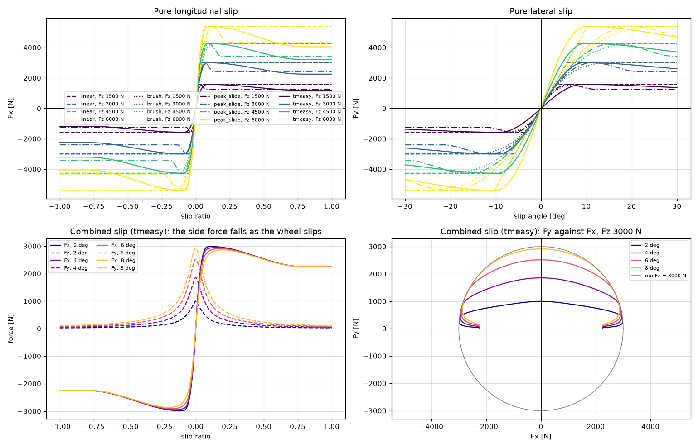

# Rally Physics Simulator



A small, deterministic rally vehicle simulator written in C++17, with Python
tools for replaying telemetry and inspecting the physics. It is an experiment
in building a vehicle model from first principles: rigid-body dynamics,
load transfer, suspension, wheel rotation, combined-slip tyres, braking and
driving.

The project includes:

- kinematic bicycle, dynamic single-track and four-wheel vehicle models;
- linear, peak-slide and TMeasy-inspired tyre curves;
- scenarios as plain-text files (circles, lane changes, braking, launch,
  handbrake turns, a jump into a hairpin) that run without rebuilding, with
  any car parameter changeable from the command line;
- finite-state checks, golden tests and CTest coverage;
- CSV telemetry with explicit units and vehicle metadata;
- top-down and 3D replays, tyre plots and animated GIFs.

## Build and test

Requirements: CMake 3.20+, a C++17 compiler, Python and the packages in
[`tools/requirements.txt`](tools/requirements.txt).

```text
cmake -S . -B build
cmake --build build --config Release
ctest --test-dir build -C Release --output-on-failure
```

## Run a scenario

```text
rallysim list                                   every scenario
rallysim fw_hairpin                             telemetry to out/runs/fw_hairpin.csv
rallysim fw_hairpin --set mu_rear=0.7 --set spring_front=45kN/m
rallysim params fw_hairpin                      every parameter --set takes
rallysim my_run.ini                             a scenario file of your own
```

The four-wheel scenarios are files in [`scenarios/`](scenarios/); the format is
in [`docs/scenario_files.md`](docs/scenario_files.md).

## Plots and replays

Install the Python plotting dependencies, then run every scenario and make
every picture:

```text
python -m pip install -r tools/requirements.txt
python tools/run_all.py
python tools/topdown.py out/runs/fw_hairpin.csv     the interactive dashboard
```

`python tools/run_all.py --gif` also makes the animated dashboards and 3D views.
Output is written under `out/`, which is ignored by git.

## A few outputs





## Where to look next

- [`docs/tools.md`](docs/tools.md) - plotting and replay tools.
- [`docs/scenario_files.md`](docs/scenario_files.md) - writing a run as a scenario file.
- [`docs/telemetry_schema.md`](docs/telemetry_schema.md) - CSV format.
- [`docs/decisions.md`](docs/decisions.md) - modelling conventions and rationale.
- [`scenarios/`](scenarios/) and [`apps/main.cpp`](apps/main.cpp) - the scenarios and the CLI.

This is a research and learning project, not a production-ready driving
simulator. Parameters are deliberately visible and many models are simplified
so that their behaviour can be tested and understood.
