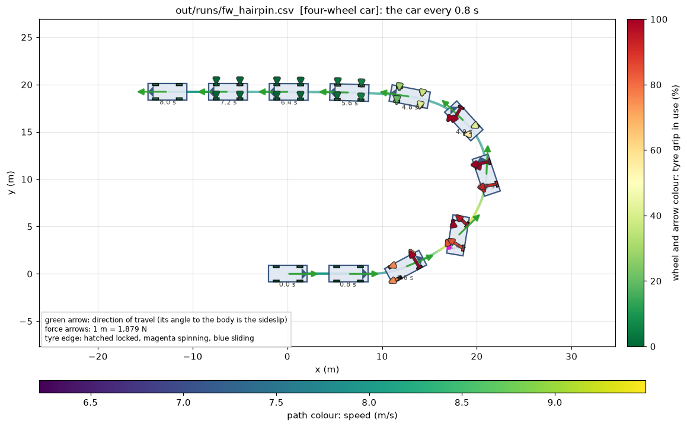
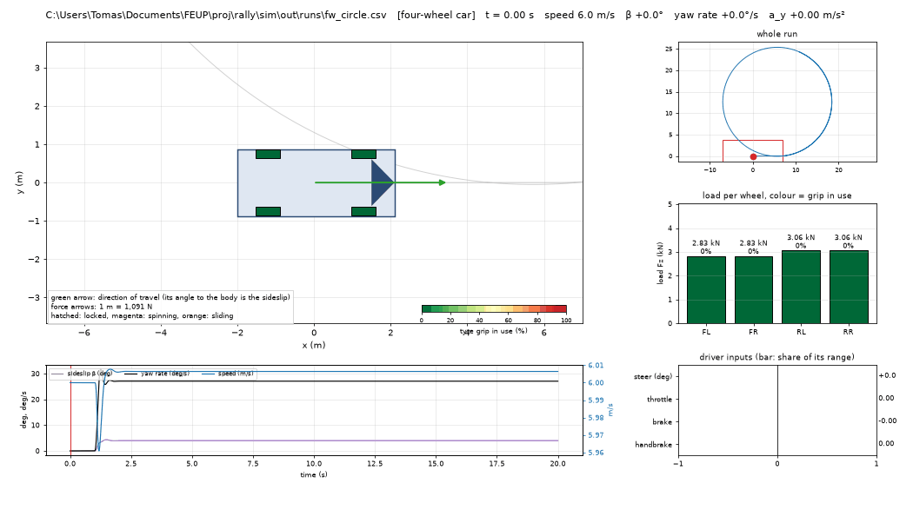
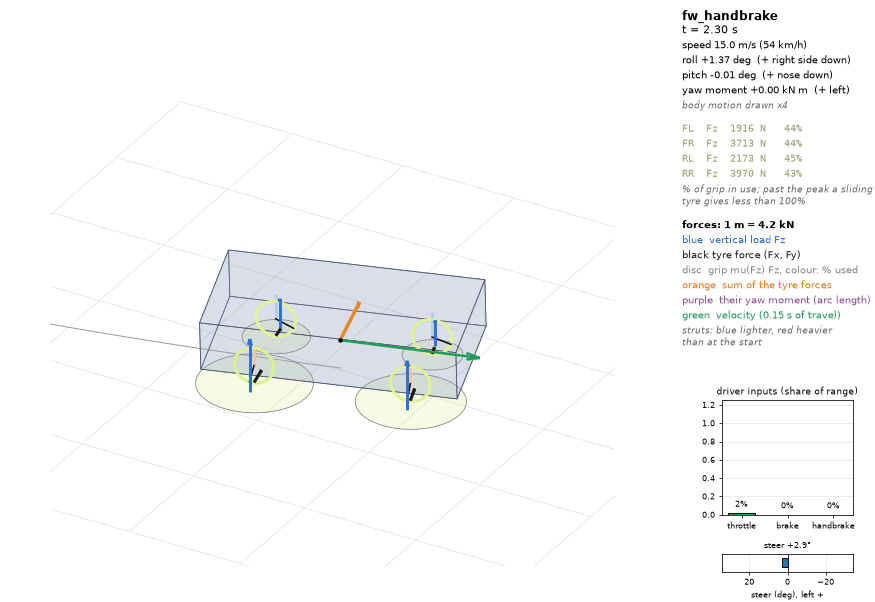
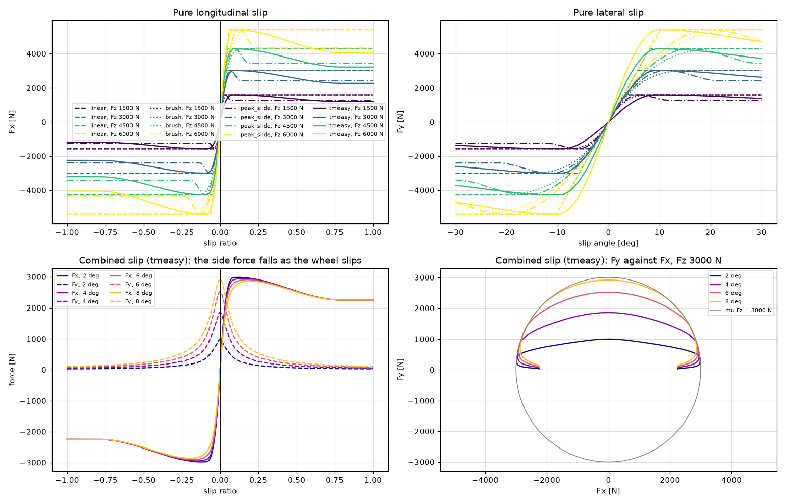
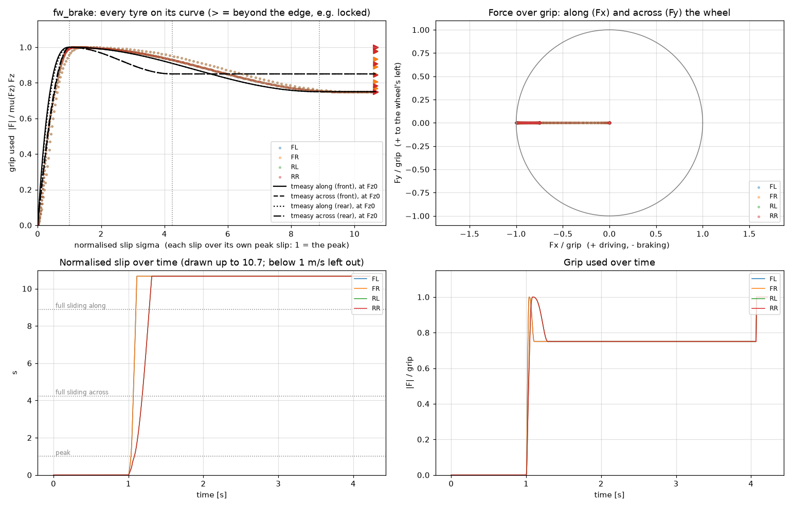
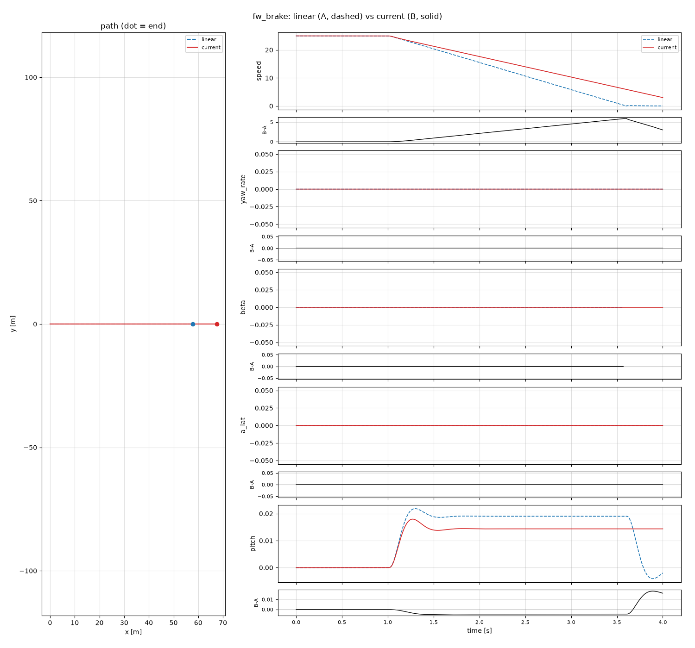
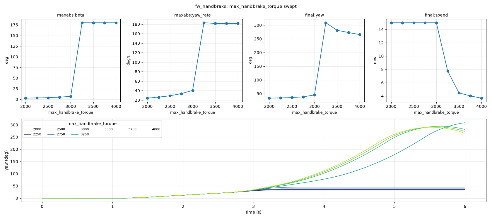
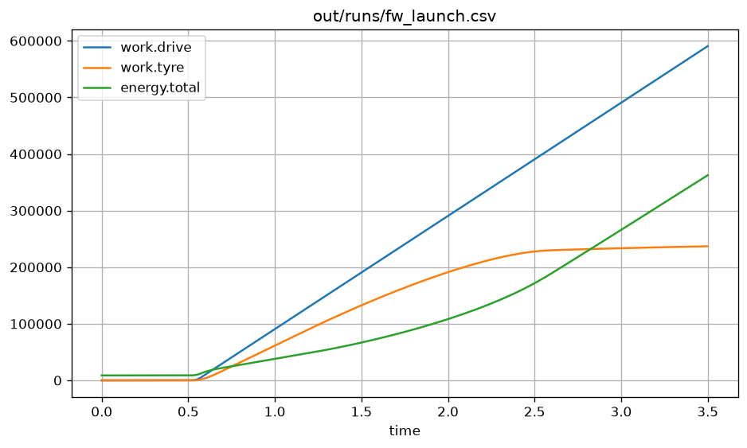

# tools/

Python tools that read what the simulator writes and draw it. They never touch the physics: `rallysim` writes CSV
files, these only read them. Everything goes under `out/`, which git ignores, so all of it can be deleted and
remade with `run_all.py`.

Run them from the `sim/` folder with `python tools/<tool>.py`; each has `--help`.
They need numpy, pandas and matplotlib, and Pillow for GIFs, all listed in `tools/requirements.txt`:

```
python -m pip install -r tools/requirements.txt
```

## Quick start

```
cmake --build build --config Release      # build rallysim first; the tools only run what is built
python tools/run_all.py                   # every scenario + the tyre rig, and all the pictures (about 20 s)
python tools/topdown.py out/runs/fw_handbrake.csv
```

## rally.py

One entry point for the analysis and the charts: `diff`, `setup`, `suspension`, `landing`, `stepsize`, `handling`,
`energy`, `characteristics`, `columns`, `overlay`, `sweep`, `path`, `tyre-points`, `tyre-rig` and `run-all`.
`python tools/rally.py --help` lists them; each has `--help`. Run `rallysim <scenario>` (or `run_all.py`) first.
The older scripts still work as short forms of some of them:

| Short form | Same as |
|---|---|
| `python tools/plot_run.py` | `python tools/rally.py columns` |
| `python tools/run_all.py` | `python tools/rally.py run-all` |
| `python tools/sweep.py` | `python tools/rally.py sweep` |
| `python tools/tyre_plot.py` | `python tools/rally.py tyre-rig` |
| `python tools/tyre_points.py` | `python tools/rally.py tyre-points` |

### diff

```
python tools/rally.py diff out/runs/fw_brake.csv out/runs/fw_launch.csv
python tools/rally.py diff out/runs/fw_brake.csv out/runs/fw_launch.csv --tol "wheel.*.slip*=1e-6,1e-4" --tol yaw=1e-3
python tools/rally.py diff out/runs/fw_brake.csv out/runs/fw_launch.csv --ignore-missing --all
```

Compares every column of two runs and prints the ones beyond tolerance, with the largest difference, the time it
occurs and the first time it passes the tolerance. A value differs when `|b - a| > abs + rel * max(|a|, |b|)`; the
default is `abs` 1e-9, `rel` 0. `--tol PATTERN=ABS[,REL]` sets it for the columns matching PATTERN, where `*`
matches any text including dots; the last matching `--tol` wins. `yaw` is compared wrapped, and `beta` is left
out where either run is below 0.3 m/s. A value that is NaN or infinite in one run only is beyond any tolerance.
Runs on different time steps are compared at A's times. Differences on line 1 (the car parameters) are printed
but never counted.

Exit 0 within tolerance, 1 beyond it, or if the columns or the end times differ (`--ignore-missing` stops the
columns counting), 2 on an error. `--all` also lists the columns within tolerance.

### setup

```
python tools/rally.py setup out/runs/fw_brake.csv out/runs/fw_showcase.csv
python tools/rally.py setup out/runs/fw_brake.csv out/runs/fw_showcase.csv --changed
```

Every line-1 parameter, one row per key and one column per run, at full precision. `*` marks a row where the
runs differ, `-` a run that lacks the key. `--changed` keeps only the marked rows.

### suspension

```
python tools/rally.py suspension out/runs/fw_circle.csv
python tools/rally.py suspension out/runs/fw_circle.csv out/runs/fw_hairpin.csv --from 3 --to 6
python tools/rally.py suspension out/runs/fw_circle.csv --save out/plots/suspension.png
```

A table with one column per run, over the last 1 s of the run, or `--from S` to `--to S` (`--to` alone: the 1 s
before it). The window means (roll, lateral acceleration, roll gradient, load transfer) read "not steady" when the
window is not steady; the three anti-roll rows (bar force per side, front and rear, and the front bar's share of the
front load transfer) read "n/a" for a run without the `arbF` columns; the peak roll, the lowest tyre load and the
largest suspension deflection are always shown.
`--save PNG` also draws the twelve-panel chart without a window; `--show` opens it. Not both. `--events` (with either)
marks the first run's events and landings as vertical lines on the panels over time.

### characteristics

```
python tools/rally.py characteristics out/runs/fw_showcase.csv --save out/plots/characteristics.png
```

Three panels from a four-wheel run: spring force against deflection, damper force against deflection speed and stop
force against deflection, one point per row and wheel (FL, FR, RL, RR). The spring and stop panels mark each axle's
rest deflection from line 1. The points are the file's own columns, so a force law that is wrong shows as points off
the expected line. The stop force needs schema 6. `--save PNG` or `--show`, not both.

### handling

```
python tools/rally.py handling out/runs/fw_lane.csv
python tools/rally.py handling out/runs/fw_lane.csv --from 1 --to 5 --save out/plots/handling.png
```

For each four-wheel run, the understeer gradient: the least-squares slope of the extra steer,
`steer - (lf + lr) * yaw_rate / speed`, against `a_lat`, in rad and in deg per m/s^2 (positive: understeer, negative:
oversteer). It uses the rows of the window (the whole run by default) at 1 m/s or faster, and is refused when
`a_lat` varies by less than 0.5 m/s^2 there. `--save PNG` also draws the two-panel diagram (extra steer and the
axle slip angles against `a_lat`); `--show` opens it. Not both.

### energy

```
python tools/rally.py energy out/runs/fw_brake.csv
python tools/rally.py energy out/runs/fw_brake.csv --save out/plots/energy.png
```

Prints the end values of the five stored energy terms, the four works, the stored energy (`energy.total` minus its
first value), the net work (drive minus brake, damper and tyre) and the residual, then the largest absolute residual
with its time. Everything comes from the file's own `energy.*` and `work.*` columns; a run without them (older
build, or not four-wheel) is refused. `--save PNG` also draws three panels over time (stored terms, works, and
stored against net work with the residual); `--show` opens it. Not both.

### landing

```
python tools/rally.py landing out/runs/fw_showcase.csv
python tools/rally.py landing out/runs/fw_showcase.csv --window 2
rallysim fw_showcase --set vertical=unsprung      # with wheel mass and stops: margins are shown
python tools/rally.py landing out/runs/fw_showcase.csv
```

The first two lines are the same: 2 s is the default, and on `fw_showcase` it shows one rebound. A landing starts when all four tyre loads have been zero (the car in the air) and the first one comes back: the
touchdown. Each landing is measured over a window of 2 s after touchdown (`--window S`), cut short at the next
flight. It prints the peak load of each tyre and:

- **settling**: the time from touchdown until every tyre load stays within 5% of its value at the end of the
  window; "not settled" if any load still varies by more than 1% over the window's last 0.5 s.
- **rebound**: a local maximum of the CG height after its lowest point that is more than 2% of the dip (the end
  height minus the lowest) above the end height. **Overshoot** is the first one's height above the end height,
  over the dip.
- **travel** and **margin**: the strut's compression past rest (from `rest_deflection_*` on line 1) and what is
  left before the bump stop (unsprung runs only). A file from an older build prints "n/a ... rerun with a newer
  build".

Overshoot and settling are measured against the window's end, so a window shorter than the body's bounce
misreads them. Use one long enough for the body to come back down.

### stepsize

```
rallysim scenarios/fw_lane.ini out/scratch/a.csv
rallysim scenarios/fw_lane.ini out/scratch/b.csv --set run.dt=0.5ms
rallysim scenarios/fw_lane.ini out/scratch/c.csv --set run.dt=0.25ms
python tools/rally.py stepsize out/scratch/a.csv out/scratch/b.csv out/scratch/c.csv
```

Compares one scenario run at dt, dt/2 and dt/4, in that order (the steps are read from line 1 and must halve
exactly). For each column, d1 is the largest difference between the first two runs, d2 between the last two, and
the ratio is d2 / d1: 0.5 means first order, 0.25 second order. A column reads "equal" when both differences are
within the tolerance, "converging" when the ratio is 0.6 or less, and "not converging" otherwise (also for a NaN in one
run). Those columns are listed first; `--all` lists the rest. Exit 0 when no column is "not converging", 1
otherwise, 2 on an error.

The tolerance is `max(1e-9, R * scale)`, where the scale is the largest absolute value, over the three runs, of all
the columns with the same unit as this one (a column with no unit uses its own largest value) and `R` is `--rel`
(default 1e-6). So a torque blip of 3e-6 N m next to torques of several N m reads "equal". The limit: a real
step-size error in a small column of a unit that also has a large column can read "equal" too; `--rel 0` keeps
only the 1e-9 floor and shows it.

A run with an event whose instant moves with the step (a wheel locking) can read "not converging" on a correct
model: compare such runs against a much finer step instead.

### columns

```
python tools/rally.py columns out/runs/st_circle.csv time speed yaw_rate
python tools/rally.py columns out/runs/fw_brake.csv time speed pitch --save out/plots/columns.png
python tools/rally.py columns out/runs/fw_circle.csv time yaw --wrapped
```

Any columns of a run against any other: the first name is the x axis, the rest are drawn one panel each. `yaw` is
drawn unwrapped, or as written with `--wrapped` (see [below](#wrapped-and-unwrapped-yaw)). `--save PNG` writes the
chart; without it the chart opens in a window. Same as `plot_run.py`.

### overlay

```
python tools/rally.py overlay out/runs/fw_brake.csv out/runs/fw_launch.csv
python tools/rally.py overlay out/runs/fw_brake.csv out/runs/fw_launch.csv --channels speed pitch --labels brake launch
python tools/rally.py overlay out/runs/fw_brake.csv out/runs/fw_launch.csv --save
```

Two or more runs: the paths side by side and each channel overlaid, with every later run minus the first underneath.
It prints each channel's largest difference, the line-1 facts that differ and both final values.
`--channels` picks the channels (default: by kind of run) and `--labels` names the runs. `--save [PNG]` writes
`out/plots/compare/<run>__<A>_vs_<B>.png` unless given a path. For two runs, `compare.py` also takes snapshots
(`--against`).

### sweep

```
python tools/rally.py sweep fw_hairpin max_handbrake_torque 1000 2000 3000
python tools/rally.py sweep fw_circle spring_front --range 30 80 6 --unit kN/m --trace roll
python tools/rally.py sweep fw_brake mu_front --range 0.5 1.1 7 --metric final:pos.x maxabs:pitch
```

One scenario over several values of one setting, its results plotted against the setting; see [sweep.py](#sweeppy)
below, which is the same command. Options: `--range FROM TO N`, `--unit`, `--metric`, `--trace`, `--set NAME=VALUE`
(held for every run), `--save PNG`, `--show`, `--exe` (the `rallysim` to use) and `--jobs N` (runs at once).

### path

```
python tools/rally.py path out/runs/fw_hairpin.csv --save out/plots/path.png
python tools/rally.py path out/runs/st_circle.csv --every 0.5 --save out/plots/path.png
```

The path of a run of any kind, coloured by speed, with the car drawn along it: about ten cars, or one every `--every S`
seconds. `--save PNG` writes it; without it the chart opens.

### tyre-points

```
python tools/rally.py tyre-points out/runs/fw_brake.csv
python tools/rally.py tyre-points out/runs/fw_brake.csv --save --min-speed 2
```

A four-wheel run's tyres on their force curve; see [tyre_points.py](#tyre_pointspy) below, which is the same command.
`--save [PNG]` writes `out/plots/tyres/<run>.png` unless given a path; without `--save` the chart opens.

### tyre-rig

```
python tools/rally.py tyre-rig
python tools/rally.py tyre-rig --save out/plots/tyres/tyre_rig.png
python tools/rally.py tyre-rig --curve peak_slide tmeasy --combined tmeasy
```

The tyre rig's force curves, from `out/rig/tyre_rig.csv` or the file given; see [tyre_plot.py](#tyre_plotpy) below,
which is the same command. `--curve` picks the curves of the pure-slip panels, `--combined` the one of the combined
panels.

### run-all

```
python tools/rally.py run-all
python tools/rally.py run-all --only fw_brake fw_launch --no-plots
python tools/rally.py run-all --snapshot linear
```

Every scenario and the tyre rig, then the path of each run, the tyres of each four-wheel run and the rig plot, into
`out/`; see [run_all.py](#run_allpy) below, which is the same command. `--only`, `--no-plots`, `--snapshot NAME`,
`--exe` and `--gif` (also the GIFs) as there; `--jobs N` is how many GIFs are made at once.

## Tests

```
python -m unittest discover -s tools/tests -t tools
```

Run from `sim/`. Two environment variables: `RALLYSIM_EXE` names a built `rallysim`, for the check against real
output (skipped without it); `RALLYTOOLS_CI=1` makes a check that cannot run fail instead of skip. CI runs the
suite on the lowest supported versions in `tools/requirements-ci.txt`. The small runs in `tools/tests/fixtures/`
are remade, deliberately, from a built `rallysim` with `python tools/tests/make_fixtures.py`.

## The tools

| Tool | Does |
|---|---|
| `rally.py` | Analysis and charts: `diff`, `setup`, `suspension`, `landing`, `stepsize`, `handling`, `energy`, `characteristics`, `columns`, `overlay`, `sweep`, `path`, `tyre-points`, `tyre-rig`, `run-all` (see [rally.py](#rallypy)) |
| `run_all.py` | Short form of `rally.py run-all`: runs every scenario and the rig, then makes the views, the tyre plots and (with `--gif`) the GIFs |
| `topdown.py` | The car seen from above: interactive dashboard, one frame, the whole path, or a GIF |
| `view3d.py` | A four-wheel run in 3D (isometric by default): the body's roll, pitch and ride height, and every force where it acts |
| `tyre_plot.py` | The tyre rig's force curves, every curve and load in one figure |
| `tyre_points.py` | A four-wheel run's tyres on their force curve, for every wheel and moment |
| `compare.py` | Two runs overlaid channel by channel, with their difference |
| `sweep.py` | One scenario over a range of one setting, its results plotted against the setting |
| `plot_run.py` | Any columns of a run against any other |
| `simdata.py` | Not a standalone tool: shared paths, file readers, running `rallysim`, and tyre curves used by the other tools |
| `input_bars.py` | Not a standalone tool: the driver's inputs as bar charts, for `topdown.py` and `view3d.py` |

### run_all.py

```
python tools/run_all.py                     every scenario + the rig, then the plots (no GIFs)
python tools/run_all.py --gif               also the GIFs: each dashboard, and each four-wheel run in 3D (slow)
python tools/run_all.py --only fw_brake fw_launch
python tools/run_all.py --snapshot linear   afterwards, keep a copy in out/snapshots/linear
python tools/run_all.py --no-plots          just the CSVs
```

It asks `rallysim list` for the scenario names, so a new scenario file in `scenarios/` (or a built-in one added to `apps/main.cpp`) is picked up on its own.
A scenario whose state stops being finite (a NaN or infinity, `core/finite.hpp`) is listed as FAILED with
`rallysim`'s message (the field, step and time); its CSV ends where the run stopped, and the script exits with 1.

The generated GIFs and plots are the quickest way to browse a complete run:



### topdown.py

```
python tools/topdown.py out/runs/fw_handbrake.csv                      dashboard: play, pause, scrub
python tools/topdown.py out/runs/fw_handbrake.csv --at 3.0 --save frame.png  # one dashboard frame
python tools/topdown.py out/runs/fw_handbrake.csv --static --save path.png  # the whole path with the car along it
python tools/topdown.py out/runs/fw_handbrake.csv --gif --start 2 --end 5  to out/gif/fw_handbrake.gif
```

Dashboard keys: space play/pause, left/right 0.1 s (shift: 1 s), up/down playback speed, home/end.
It reads every kind of run (rigid body, bicycle, single-track, four-wheel) and draws the car from line 1 of the file.
Other options: `--every S` (seconds between cars in the static view), `--fps`, `--speed` (GIF playback speed), `--window M` (width
of the view that follows the car), `--no-follow` (the whole path in the main view).

The dashboard shows the car on its path with each tyre's force, coloured by the grip in use, and at the CG the sum of
the tyre forces (orange) and their yaw moment (purple arc, longer for a larger moment). Around it: the whole run, the
g-g diagram (the car's acceleration in g, from the tyre forces over the mass), the load on each wheel, the driver's
inputs (the pedals upright, the steer across, left of zero when steering left), and sideslip, yaw rate and speed
over time. The static view (`--static`) draws only the tyre forces.



### view3d.py

```
python tools/view3d.py out/runs/fw_handbrake.csv                       play, pause, scrub, drag to turn the view
python tools/view3d.py out/runs/fw_brake.csv --at 1.6 --save brake3d.png    one frame
python tools/view3d.py out/runs/fw_handbrake.csv --gif --start 2.3 --end 4.3   to out/gif/fw_handbrake_3d.gif
python tools/view3d.py out/runs/fw_circle.csv --chase --perspective    behind the car, perspective
```

The vertical side of a run, which `topdown.py` cannot show: the body at its real pose (roll, pitch and ride height,
exaggerated x4 by default, `--exaggerate 1` for true scale; the HUD gives the true angles), wheels that steer and spin
(a locked wheel's spoke stops), struts coloured by how loaded each corner is. At each contact patch: the vertical load
(blue, standing just outboard of the wheel), the tyre force on the ground (black), and the grip mu(Fz) Fz as a disc
coloured by the share in use, so the black arrow reaching the disc's edge is the tyre at its limit; at the CG, the
velocity (green), the sum of the tyre forces (orange) and their yaw moment (purple arc, longer for a larger moment).
Every force uses one scale, printed in the HUD, and is drawn over the body and wheels so none hides behind the car.
The HUD also shows the driver's inputs as bars. The camera is isometric (a parallel projection, so arrows keep their
true length anywhere in the picture); `p` switches to perspective, `c` to a chase camera. Four-wheel runs only. Other options: `--fps`, `--speed`, `--window M`, `--elev` and `--azim` (the camera angles in degrees). GIFs
take about 7 to 8 s per second of run.



### tyre_plot.py

```
python tools/tyre_plot.py                              reads out/rig/tyre_rig.csv
python tools/tyre_plot.py --save out/plots/tyres/tyre_rig.png
python tools/tyre_plot.py --curve peak_slide                  every panel on peak_slide
python tools/tyre_plot.py --curve peak_slide tmeasy --combined peak_slide
```

Fx against slip ratio and Fy against slip angle at each load (colour: load; dashed linear, dotted brush, dash-dot
peak_slide, solid tmeasy), then the combined sweeps of one curve (`--combined`, else the first `--curve`, else tmeasy,
the car's tyre): the side force
falling as the wheel slips, and Fy against Fx inside the grip circle. Make the CSV with `rallysim tyre_rig` (or
`run_all.py`). Comparing peak_slide and tmeasy here shows what the two-load tables buy: tmeasy's side force peaks at
about 9-10 degrees at every load, peak_slide's moves from 6 to 20.

Use this tool to study the tyre in isolation. The top-left and top-right
panels are pure longitudinal and pure lateral tests: they show how stiffness,
peak grip and sliding behaviour change with vertical load. The lower-left panel
shows combined slip, where braking or driving consumes some of the force
available for cornering. The lower-right panel shows the same result as a
force envelope; every trace should remain inside the grey `mu Fz` grip circle.



### tyre_points.py

```
python tools/tyre_points.py out/runs/fw_brake.csv
python tools/tyre_points.py out/runs/fw_brake.csv --save    to out/plots/tyres/fw_brake.png
```

Every tyre at every moment as a point on its curve: across, the normalised slip; up, the grip used, |F| / mu(Fz) Fz.
For linear and peak_slide tyres the slip is scaled so 1 is where the linear tyre reaches its grip, and every load
collapses onto one curve. For tmeasy tyres (the car's) it is sigma, each slip over its own peak slip, so 1 is the peak
in every direction; each direction has its own curve, drawn at the nominal load, and mixed slips sit between them.
Hard braking climbs the curve and pins at the locked edge; steady cornering sits on it. The
slips in the file are the steady ones while the force comes from the relaxed ones, so in fast transients the
points loop off the curve (that is the relaxation lag, not an error). Below 1 m/s (`--min-speed`) points are left out.

Use this tool to study a complete four-wheel run rather than the tyre model in
isolation. The top-left panel answers "how close is each wheel to its tyre
curve?"; the top-right shows how each wheel shares its available grip between
longitudinal and lateral force. The bottom panels show when slip builds and
how much grip is used over time. This makes braking, corner entry, wheelspin
and handbrake events easy to identify, while the wheel colours show which
corner is responsible.



### compare.py

```
python tools/compare.py A.csv B.csv                           default channels for the kind of run
python tools/compare.py A.csv B.csv speed beta wheel.FL.slipRatio  # pick the channels
python tools/compare.py A.csv B.csv --labels old new --save out/plots/compare/brake.png
python tools/compare.py --against linear fw_brake             out/snapshots/linear/runs/fw_brake.csv vs out/runs
python tools/compare.py --against linear --all                every run in both, into out/plots/compare/
```

A dashed, B solid, B - A underneath each channel (`--channels` picks them, `--labels` names the runs). It prints the largest difference of each channel, both final
values, and which line-1 facts (car parameters) differ between the files, so you can see what changed.



### sweep.py

```
python tools/sweep.py fw_hairpin max_handbrake_torque 1000 2000 3000 4000
python tools/sweep.py fw_hairpin max_handbrake_torque --range 1000 4000 7   7 values from 1000 to 4000
python tools/sweep.py fw_circle spring_front --range 30 80 6 --unit kN/m --metric maxabs:roll --trace roll
python tools/sweep.py fw_showcase driver.max_yaw_rate 40deg/s 60deg/s 80deg/s --set mu_rear=0.85
```

Runs the scenario once per value (`rallysim <scenario> --set <setting>=<value>`, several at once), so the setting is
anything `--set` takes, units included, and `--set` holds other values for every run. A metric is
`statistic:column` (`max`, `min`, `maxabs`, `mean`, `final`, `range`), angles shown in degrees; the defaults are
the peak sideslip and yaw rate and the final heading and speed. The picture has each metric against the value, and
`--trace` (default `yaw_rate`) over time for every value. A metric that does not change is drawn flat.

The runs and `summary.csv` (one row per value) go to `out/sweeps/<scenario>__<setting>/`, the picture to
`out/plots/sweeps/`.

The handbrake flick against the handbrake's torque (`python tools/sweep.py fw_handbrake max_handbrake_torque --range
2000 4000 9 --trace yaw`): up to 3000 N m the rear steps out and the car recovers; from 3250 N m it spins.



### plot_run.py

```
python tools/plot_run.py out/runs/st_circle.csv time speed yaw_rate
python tools/plot_run.py out/runs/st_circle.csv time speed --save speed.png
python tools/plot_run.py out/runs/fw_brake.csv time energy.residual      the energy books' residual
python tools/plot_run.py out/runs/fw_launch.csv time work.drive work.tyre energy.total   where the energy went
```

Every four-wheel run carries its energy books (`energy.*`, `work.*`, `energy.residual`; `telemetry_schema.md`).
After a physics change, a residual that grows with time and does not halve when dt halves points at a bug.

`yaw` is drawn unwrapped by `plot_run.py` and `compare.py`; `plot_run.py --wrapped` plots it as written. See
[Wrapped and unwrapped yaw](#wrapped-and-unwrapped-yaw) below.



## out/

| Folder | Holds | Written by |
|---|---|---|
| `out/runs/` | One telemetry CSV per scenario (`telemetry_schema.md`) | `rallysim <scenario>` |
| `out/rig/` | `tyre_rig.csv`: force against slip for each tyre curve, no car | `rallysim tyre_rig` |
| `out/plots/views/` | A top-down picture of each run | `topdown.py --static` |
| `out/plots/tyres/` | `tyre_rig.png`, and each four-wheel run's tyres on their curve | `tyre_plot.py`, `tyre_points.py` |
| `out/plots/compare/` | Two runs overlaid, with their difference | `compare.py --save` |
| `out/plots/sweeps/` | One picture per sweep | `sweep.py` |
| `out/sweeps/<scenario>__<setting>/` | A sweep's runs and its `summary.csv` | `sweep.py` |
| `out/gif/` | Each run's dashboard (`<run>.gif`) and each four-wheel run in 3D (`<run>_3d.gif`) | `topdown.py --gif`, `view3d.py --gif` |
| `out/snapshots/<name>/` | Saved copies of `runs/` and `rig/`, to compare later runs against | `run_all.py --snapshot <name>` |

`rallysim <scenario> [path]` writes to `out/runs/<scenario>.csv` (the rig to `out/rig/`) unless given a path;
`rallysim list` prints the scenario names. A four-wheel scenario's car can be changed without rebuilding:
`rallysim fw_hairpin --set spring_front=60000 --set mu_rear=0.8`; `rallysim params [scenario [--set name=value]...]` lists the names with
their values (with the settings applied, as in a run) (`vehicle/four_wheel_registry.hpp`), and line 1 of the file records the values the run used. A value
may carry a unit of the same kind, converted to the parameter's own: `--set spring_front=50kN/m`,
`--set brake_bias_front=62%`, `--set max_steer=30deg`. `rallysim file.ini` runs a four-wheel scenario written as a
file (to `out/runs/<file name>.csv`); there `--set` also reaches the other sections: `--set run.dt=0.5ms`. The format is in [`scenario_files.md`](scenario_files.md).

## A typical check after a physics change

```
python tools/run_all.py --snapshot before      # before the change: keep the old results
(make the change, rebuild)
python tools/run_all.py                        # the new results and pictures
python tools/compare.py --against before --all # what moved, run by run, into out/plots/compare/
```

## Keeping the tools in step with the C++

- Look columns up by name, never by position (`telemetry_schema.md`).
- `simdata.py` repeats the tyre of `vehicle/tyre.hpp` (`grip`, `tyre_forces` for every curve, `tmeasy_at`,
  `tmeasy_combine`, `pure_slip_curve`) so `tyre_points.py` can put the tyres on their curves. If the C++ tyre changes,
  change it there too: `tyre_points.py` warns when the two differ by more than 1 N on any row of
  `out/rig/tyre_rig.csv` (every curve, sweep and load).
- A new tyre parameter the tools need goes on line 1 of the four-wheel files (`four_wheel_meta`) and into
  `simdata.TYRE_DEFAULTS`.

## Wrapped and unwrapped yaw

`yaw` is the car's heading in the world frame: the angle from the world x axis, counter-clockwise. The single-track
and four-wheel files take it from the body's orientation (`yaw_angle` in `core/rigid_body.hpp`, an `atan2`), so it
is always between -pi and pi, like a compass: after 179 degrees comes -179 degrees, the same direction a little
further round. The bicycle integrates its yaw (`yaw += r dt`), so its files keep counting.

Both say where the car points; they only label it differently. Going round a circle:

```
time ->        lap 1                         lap 2
wrapped:    0 -> 90 -> 180 | -180 -> -90 -> 0 -> 90 -> 180 | -180 ...
unwrapped:  0 -> 90 -> 180 ->  180 ->  270 -> 360 -> 450 -> 540 ...
```

Wrapped, it plots as a sawtooth, one tooth per lap. Unwrapped (`np.unwrap`, which removes each 2 pi jump), the angle
keeps counting, like an odometer, and plots as one continuous line whose slope is the yaw rate.

| To see | Use |
|---|---|
| How many turns the car made, how smoothly it turns | unwrapped (the default in `plot_run.py` and `compare.py`) |
| Which way the car points now, as a compass direction | wrapped (`plot_run.py --wrapped`) |
| Two runs compared | unwrapped: no false spikes when one run crosses +-pi a moment before the other |

The CSV keeps the wrapped value, the usual convention for a stored heading; only the plots unwrap it
(`simdata.unwrap_headings`). `compare.py` also wraps the difference B - A back into -pi to pi, so two runs a whole
lap apart do not show a 2 pi difference. `topdown.py` only uses yaw to turn the car drawing, where it makes no
difference.
